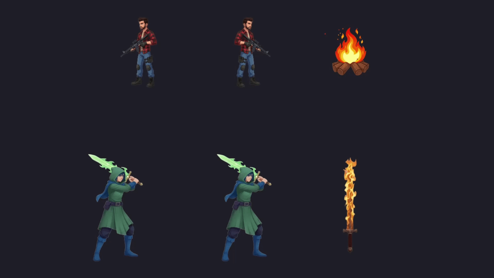

<h1 align="center">💫 SDL3 SIMPLE SPRITE ANIMATIONS</h1>

---

---

### 📌 Developer Notes

* **Stack:** C++20, Custom ECS, SDL3.
* **Decoupled Sprite Loading:** Sprites are loaded with `src/asset/SDL3/texture_manager.hpp` and mapped with components using IDs.
* **Static Sprites:** Static sprites are created using the `src/engine/components/sprite.hpp` component.
  * To load and use a static sprite, check `src/game/prefabs/unit_prefab.cpp`.
* **Animated Sprites:** Animated sprites are created using `src/engine/components/animated_sprite.hpp` and processed with `src/engine/systems/animation_system.cpp`.
  * To load and use an animated sprite, check `src/game/prefabs/unit_attack_prefab.cpp`.
* **Render System:** The render system `src/game/systems/SDL3/render_system.cpp` provides a simple `draw_sprite` function.
  * In order to render a sprite, an entity must have the `src/engine/components/render.hpp` component.
* **Custom ECS:** Create additional components and systems under the namespaces `Game` or `Engine`.
  * **Engine:** The Engine namespace contains more abstract engine-level components and systems.
  * **Game:** The Game namespace contains game-specific components, systems, the runtime loop, prefabs, etc.
* **Context:** Context is a registry that contains component stores and dependencies like `SDL_Renderer` and `TextureManager`.
  * Engine namespace should not depend on Game namespace dependencies.
  * Register new component stores in either `src/game/context.hpp` or `src/engine/context.hpp` depending on the component namespace.

---

### 🙏 Credits

Built with [SDL3](https://github.com/libsdl-org/SDL).